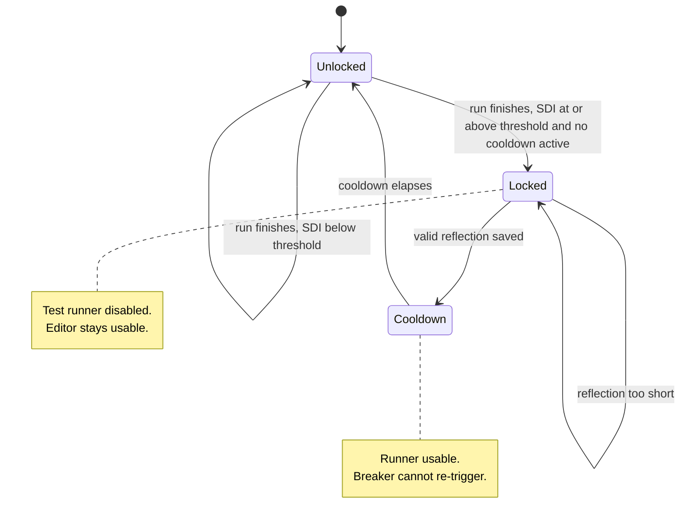
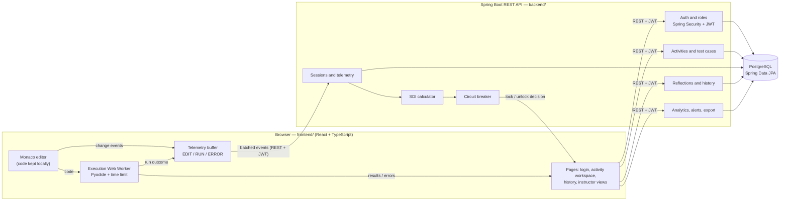
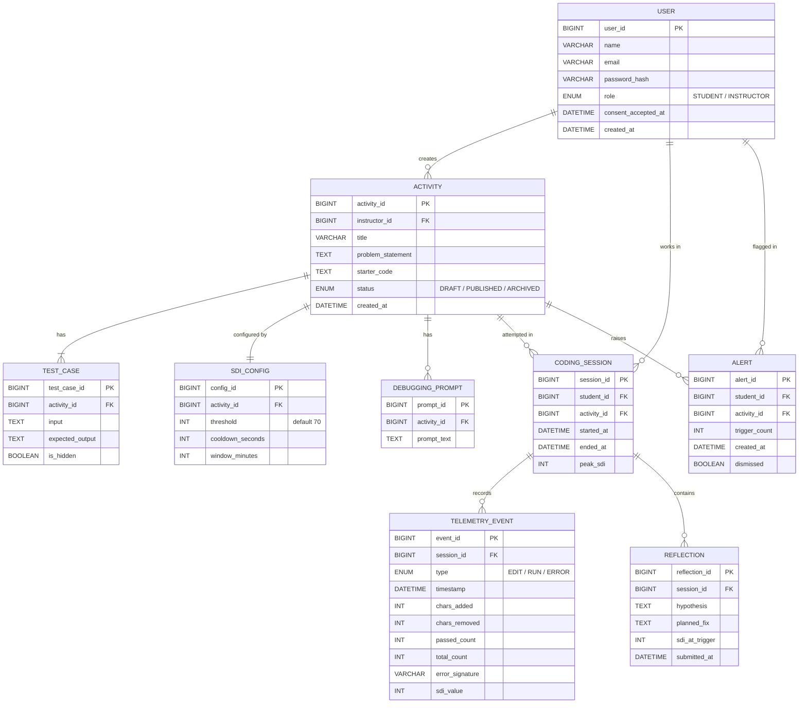
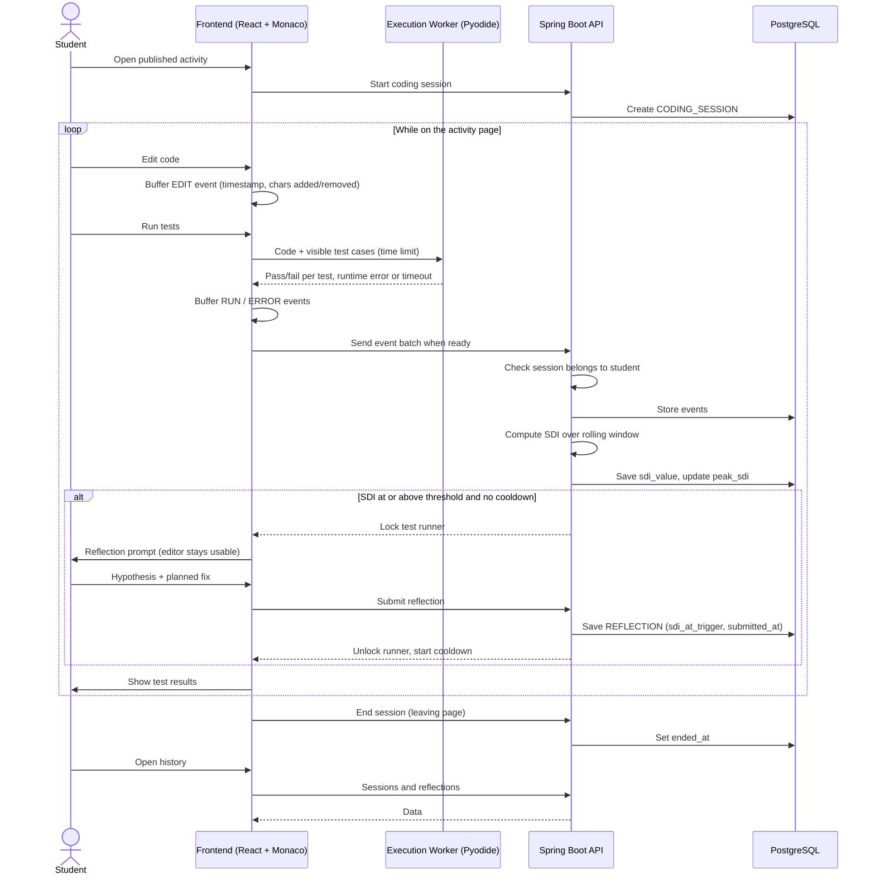

# EpistemicTrace — Project Documentation

| | |
|---|---|
| **Team** | Episteme Labs — Adrian Bona, Noel Arcenio Cortes, Jacob Roph A. Bucton |
| **Course** | CSIT321 – Applications Development and Emerging Technology, CIT-U |
| **Status** | Pre-implementation: repository scaffold only (see [§11.1](#111-current-status)) |
| **Last reconciled** | 2026-10-29 |

This is the reference for **what** EpistemicTrace is and **how** it is meant to work: problem, users, requirements, architecture, data model, data flow, plan, limitations and open questions.

- Rules for AI agents and contributors: [`../AGENTS.md`](../AGENTS.md)
- Board structure, cards, acceptance criteria and progress: [`TRELLO.md`](TRELLO.md)

**Sources reconciled into this file:**

- *CSIT321 – Project Documentation* (team Google Doc, last edited 2026-10-26)
- Trello board [Episteme Labs — EpistemicTrace](https://trello.com/b/nwPfFX7D/episteme-labs-epistemictrace) (snapshot 2026-10-29)
- This repository at commit `8ac4dbe` ("chore: initial monorepo scaffold")

Where the sources disagree, see [§16 Reconciliation](#16-reconciliation-with-existing-documentation).

**Status tags used below:**

- **Decided**: agreed in the sources above. Change it only through the process in [§14](#14-decision-log).
- **In repo**: already present in code or config.
- **Assumption**: a reasonable reading of the sources that the team has not confirmed.
- **Open (Q-xx)**: unresolved; see [§15](#15-open-questions).

---

## Contents

1. [Overview](#1-overview)
2. [Problem](#2-problem)
3. [Solution](#3-solution)
4. [Users, roles and team](#4-users-roles-and-team)
5. [Objectives](#5-objectives)
6. [Requirements](#6-requirements)
7. [Feature specifications](#7-feature-specifications)
8. [Architecture](#8-architecture)
9. [Data model](#9-data-model)
10. [Data flow](#10-data-flow)
11. [Implementation plan and status](#11-implementation-plan-and-status)
12. [Limitations and risks](#12-limitations-and-risks)
13. [Future enhancements](#13-future-enhancements)
14. [Decision log](#14-decision-log)
15. [Open questions](#15-open-questions)
16. [Reconciliation with existing documentation](#16-reconciliation-with-existing-documentation)
17. [Glossary](#17-glossary)
18. [References](#18-references)

---

## 1. Overview

EpistemicTrace is a web-based coding platform for programming courses. It records **how** students solve programming problems, not only whether the final code passes:

- **Telemetry:** while a student works on an activity, the platform records code edits, test runs, errors, passing-test counts and timing.
- **SDI:** from that telemetry it computes a **Struggle Dynamics Index (SDI)** from 0 to 100, which rises when a student shows signs of *wheel-spinning*.
- **Circuit breaker:** when the SDI reaches a threshold, a **Metacognitive Circuit Breaker** pauses the test runner until the student writes a hypothesis and a planned fix.
- **Instructor view:** instructors see process analytics, so they can tell which students and activities need support.

## 2. Problem

Automated grading platforms judge only the final submission. They show whether code passes its tests, not how the student got there.

When students meet an error they do not understand, many fall into unproductive trial and error: rapid, small edits and repeated test runs without a clear idea of what is wrong. This pattern is known as **wheel-spinning** [1], [2]. It causes frustration and fatigue, and the time spent rarely turns into learning.

Instructors see little of this struggle. A grade report shows who passed, but not who spent an hour repeating the same error or which activities troubled the whole class. By the time results come in, the chance to help during the activity is gone. Of the tools the team reviewed (CodeHS, Codio, CodeGrade):

- some record coding history or flag struggling students;
- none intervenes **during** the session to make the student stop and plan before trying again.

## 3. Solution

EpistemicTrace closes that gap with four parts:

1. **In-browser workspace:** students write Python in a Monaco editor and run it against instructor-defined test cases. Execution uses Pyodide inside a Web Worker with a time limit, so an infinite loop cannot freeze the page.
2. **Process telemetry:** edits, runs, errors and pass counts are timestamped per coding session, recorded only on the activity page, and stored through the REST API.
3. **Struggle Dynamics Index:** computed after every test run from four signals in a rolling window ([§7.5](#75-struggle-dynamics-index-sdi-fr-m6-tel-03)).
4. **Metacognitive Circuit Breaker:** at the threshold, the test runner locks while the editor stays usable. The student must submit a hypothesis and a planned fix to unlock it, and a cooldown prevents an immediate re-trigger.

This applies Loksa et al.'s finding [6] that explicit problem-solving prompts improve novices' productivity and metacognitive awareness. The SDI combines ideas from the Error Quotient [3], [5] and Repeated Error Density [4] with test-run frequency, edit-to-run timing and progress in passing tests.

**Guiding principle (Decided):** the SDI is used only to prompt reflection and to inform instructors. It is **never** used to penalize grades.

## 4. Users, roles and team

### 4.1 Application roles

| Role | What they do in the app | Source |
|---|---|---|
| **Student** | Opens published activities, writes and runs code, receives reflection prompts, reviews own sessions and reflections. | CSIT321 doc; Trello |
| **Instructor** | Creates and manages activities and test cases, adjusts SDI settings, views analytics, reviews student reflections. | CSIT321 doc; Trello |

Only these two roles exist (`role` = `STUDENT` / `INSTRUCTOR` in the data model). There is no admin role. Who creates instructor accounts is open: Q-04.

### 4.2 Course and team roles (not application roles)

| Person | Team role | Notes |
|---|---|---|
| Adrian Bona | Member A | Takes the hardest implementation parts (execution sandbox, SDI engine, circuit breaker). |
| Noel Arcenio Cortes | Member B | |
| Jacob Roph A. Bucton | Member C | Also owns the process and documentation sprint tasks. |
| Course professor | Member D | **Only monitors progress.** Never an assignee or reviewer on the board. |

Card ownership and workload are in [`TRELLO.md` §5](TRELLO.md#5-team-and-workload).

> The current `README.md` describes the users as "Students" and "Professor (monitors only)". This document treats the **professor** as a course stakeholder and the **instructor** as the in-app role, as the CSIT321 doc and the Trello cards do. See R-02 in [§16](#16-reconciliation-with-existing-documentation).

## 5. Objectives

From the CSIT321 doc (SMART objectives):

1. **Workspace:** within the course term, develop a web-based coding workspace where students write Python in the browser and run it against instructor-defined test cases, with a pass/fail result shown for every test case.
2. **Telemetry:** by the MVP demonstration, record edits, test runs, errors, passing-test counts and timestamps for every coding session on the activity page. Store them per session, with access limited to the student and their instructor.
3. **SDI and circuit breaker:** implement both so that, in unit and acceptance tests run before the MVP demonstration:
   - a seeded wheel-spinning session scores **above** the default threshold of **70**;
   - a steady-progress session scores **below** it;
   - the runner locks and unlocks correctly in every test.
4. **Instructor dashboard:** within the course term, deliver a dashboard with per-student process analytics, a difficulty heatmap and CSV export, verified against each feature's acceptance criteria.
5. **Pilot:** gather pilot students' feedback on whether the reflection prompts helped. Use it, together with pilot session data, to calibrate the SDI weights and threshold before the end of the course term.

The course term dates, MVP demo date and pilot plan are not recorded anywhere yet: Q-10.

## 6. Requirements

### 6.1 Functional requirements

The requirement wording is from the CSIT321 doc. The Trello mapping comes from the board. Per-card acceptance criteria live in [`TRELLO.md` §8](TRELLO.md#8-card-inventory), not here.

**Must have**

| ID | The system shall… | Trello |
|---|---|---|
| FR-M1 | let users register, log in and log out, and restrict pages by role (student or instructor). | PLT-01 |
| FR-M2 | let instructors create, edit, publish and archive coding activities with a problem statement and test cases. | PLT-02 |
| FR-M3 | provide an in-browser code editor with Python syntax highlighting that keeps the student's code after a page refresh. | CW-01, CW-03 |
| FR-M4 | run student code against the activity's test cases in a sandboxed Web Worker, stop runs that exceed a time limit, and show each test case's pass/fail result and any runtime error. | CW-02, CW-03 |
| FR-M5 | record code edits, test runs, errors, passing-test counts and timestamps for each coding session, only on the activity page. | TEL-01, TEL-02 |
| FR-M6 | compute a Struggle Dynamics Index (SDI) from 0 to 100 over a rolling window after every test run. | TEL-03 |
| FR-M7 | pause the test runner when the SDI reaches the threshold, require a hypothesis and a planned fix before unlocking it, and apply a cooldown before it can trigger again. | MCB-01, MCB-02 |
| FR-M8 | let students review their past sessions and reflections. | STU-01 |

**Should have**

| ID | The system should… | Trello |
|---|---|---|
| FR-S1 | provide an instructor dashboard showing test runs, session time, peak SDI and circuit-breaker triggers per student, filterable by activity. | INS-01 |
| FR-S2 | display a difficulty heatmap comparing the average or peak SDI across activities. | INS-02 |
| FR-S3 | let instructors configure the SDI threshold and cooldown per activity, rejecting out-of-range values. | INS-03 |
| FR-S4 | alert instructors when a student triggers the circuit breaker repeatedly on the same activity. | INS-04 |
| FR-S5 | export telemetry as JSON or CSV by activity and date range, with an option to anonymize student identifiers. | INS-05 |
| FR-S6 | show students a struggle-level indicator (low, medium or high) that updates after each test run. | STU-02 |

**Could have (nice to have)**

| ID | The system may… | Trello |
|---|---|---|
| FR-C1 | offer an optional AI Socratic assistant that responds with guiding questions and never returns a full solution. | AI-01 |
| FR-C2 | generate reflective questions from the student's latest error, code change and hypothesis, shown inside the circuit-breaker prompt. | AI-02 |
| FR-C3 | let instructors write per-activity debugging prompts that appear when the AI assistant is disabled or unavailable. | AI-03 |

**Two requirements in the CSIT321 doc have no Trello card yet:**

- **Consent notice:** "Students see a consent notice before their first session" (supported by `consent_accepted_at` in the data model). Q-05.
- **Instructor review of reflections:** "lets instructors review the reflections their students submitted" (Feature 7). STU-01 covers only the student view. Q-06.

### 6.2 Quality and constraint requirements

Each line is traceable to a source. These are the invariants that [`AGENTS.md`](../AGENTS.md) tells agents never to weaken.

| ID | Requirement | Source |
|---|---|---|
| NFR-01 | Student code runs only in the browser, inside a Web Worker. Runs that exceed a time limit are stopped, so an infinite loop never freezes the page. | CSIT321 doc; CW-02 |
| NFR-02 | Telemetry is captured **only on the activity page**. | FR-M5; TEL-01 |
| NFR-03 | A student can write only their own telemetry events. Session data is readable only by that student and their instructor. | TEL-02; Objective 2 |
| NFR-04 | The SDI is always within 0–100 and recalculates after each run. | TEL-03 |
| NFR-05 | The SDI is never used to penalize grades. Student-facing struggle indicators show levels (low/medium/high), not raw scores or punishing wording. | CSIT321 doc; STU-02 |
| NFR-06 | The editor stays usable while the test runner is locked. | MCB-01 |
| NFR-07 | Students see a consent notice before their first session. | CSIT321 doc |
| NFR-08 | Exports can anonymize student identifiers. | FR-S5; INS-05 |
| NFR-09 | The session history page opens in under 3 seconds. | STU-01 |
| NFR-10 | Real secrets are never committed. Configuration comes from a local, git-ignored `.env`. | SP-07; `.env.example`; `.gitignore` |
| NFR-11 | The AI assistant, if built, never returns a full solution and logs its responses. | FR-C1; AI-01 |

The test conditions behind NFR-09 (data volume, network, device) are not defined: Q-16.

### 6.3 Out of scope (this iteration)

- **Languages other than Python.** The workspace is Python-only via Pyodide. The README lists multi-language execution as Won't-have.
- **Real-time collaborative editing** (README, Won't-have).
- **Grading or scoring of submissions** based on the SDI (NFR-05). Whether the platform grades at all is not stated; the documentation describes only pass/fail test feedback.

## 7. Feature specifications

These summarize the behavior agreed in the CSIT321 doc, its UML activity diagrams and the Trello cards. Each feature's acceptance criteria are in [`TRELLO.md`](TRELLO.md#8-card-inventory).

### 7.1 User authentication and roles (FR-M1, PLT-01)

- Register, log in and log out. The role is stored on the account.
- After login, the user lands on the dashboard for their role. A student cannot open instructor pages, and an invalid login shows an error message.
- Planned mechanism: Spring Security with JWT (D-04).

### 7.2 Course and activity management (FR-M2, PLT-02)

- An instructor creates an activity: title, problem statement, starter code and test cases (input and expected output; a test case can be hidden).
- An activity cannot be saved without at least one test case.
- Lifecycle: `DRAFT` → `PUBLISHED` → `ARCHIVED`. Students see only published activities.
- **Gap:** the feature is named "Course and…", but the data model has **no course, class or enrollment entity**, so nothing defines which students belong to which instructor. Q-03.

### 7.3 In-browser code editor and execution (FR-M3, FR-M4; CW-01, CW-02, CW-03)

- **Editor:** a Monaco editor with Python highlighting. Code is kept locally across page refreshes: saved code is restored, otherwise the starter code loads. Monaco change events are emitted on every keystroke and feed the telemetry.
- **Running tests:** "Run tests" executes the code in a Web Worker running Pyodide. If the run exceeds the time limit, the worker is stopped and a timeout is shown. Otherwise a runtime error is shown, or pass/fail per test case.
- **Layout:** problem statement, editor and results panel are visible together on desktop.
- **Undefined values:** the time limit and how hidden test cases are presented to students. Q-12.

### 7.4 Real-time coding telemetry (FR-M5; TEL-01, TEL-02)

- A session starts with an ID when the student opens the activity page. Its end time is recorded when they leave.
- **Event types** are `EDIT`, `RUN` and `ERROR`, each timestamped and tied to the session:

  | Event | Carries |
  |---|---|
  | `EDIT` | characters added / removed |
  | `RUN` | passed and total test counts |
  | `ERROR` | error signature |

- **Batching:** events are buffered and sent in batches to the REST API. The server rejects a batch if the session does not belong to the student.
- **Not yet defined (Q-08):**
  - the batch payload ("agreed schema" in TEL-01);
  - when a batch is "ready" (size or time);
  - how an error *signature* is derived;
  - which side generates the session ID.

### 7.5 Struggle Dynamics Index (SDI) (FR-M6; TEL-03)

Computed after every test run over a rolling window of the session's events:

| # | Signal | Raises SDI when… |
|---|---|---|
| 1 | Test-run frequency | tests are run often |
| 2 | Time between edit and run | little time passes between an edit and the next run |
| 3 | Repeated error signatures | the same error keeps recurring |
| 4 | Runs with no progress | runs pass without any increase in passing tests |

**Calculation:**

1. Normalize each signal.
2. Take the weighted sum of the four normalized signals.
3. Multiply by 100 and clamp the result to 0–100.

**Recording:**

- Each run's SDI is saved on its `RUN` event (`sdi_value`).
- The session's `peak_sdi` is updated when exceeded.
- The value is then passed to the circuit breaker.

**Settings:**

| Setting | Value | Status |
|---|---|---|
| Default threshold | **70** | Decided; per-activity override via INS-03 |
| Signal weights | not set | Open: starting values, to be calibrated with pilot data |
| Normalization method | not set | Open |
| Window length (`window_minutes`) | not set | Open |

These open settings are Q-01. Until they are decided, implementations must keep weights, window and threshold **configurable, not hard-coded** (see AGENTS.md).

**Verification (Objective 3, TEL-03):** unit tests where a seeded wheel-spinning sequence scores above the threshold and a steady-progress sequence scores below it.

Where the SDI is computed (browser or server) is open: Q-02.

### 7.6 Metacognitive Circuit Breaker (FR-M7; MCB-01, MCB-02)



**Flow:**

1. **Trigger:** after a run, the breaker checks: *SDI ≥ threshold and not in cooldown*.
2. **Lock:** if the check is true, the test runner locks and a reflection prompt asks for a **hypothesis** and a **planned fix**. Both fields must meet a minimum length.
3. **Unlock:** on submit, the reflection is saved with a timestamp and the SDI at trigger (`sdi_at_trigger`). The cooldown starts, the runner unlocks, and the triggering run's test results are shown.

**Undefined (Q-11):** the minimum length, the default cooldown, and whether a lock survives a page reload.

### 7.7 Session and reflection history (FR-M8; STU-01)

- **Student view:** students see their sessions (date, activity, duration, peak SDI) and open one to see its reflections with timestamps and SDI values. With no sessions, an empty-state message is shown.
- **Performance:** the page must open in under 3 seconds (NFR-09).
- **Instructor view** of student reflections: Q-06.

### 7.8 Should-have and could-have features

These are summarized in [§6.1](#61-functional-requirements), with full acceptance criteria in [`TRELLO.md`](TRELLO.md#8-card-inventory). Values that still need defining:

| Feature | Undefined value | Question |
|---|---|---|
| Heatmap (INS-02) | average **or** peak SDI | Q-13 |
| Early-warning alerts (INS-04) | trigger count N | Q-14 |
| Struggle indicator (STU-02) | SDI ranges for low / medium / high | Q-15 |
| AI features | provider, cost and privacy rules | Q-09 |

## 8. Architecture

### 8.1 Technology stack

| Layer | Technology | Status | Source |
|---|---|---|---|
| Frontend framework | React 19, TypeScript ~6.0, Vite 8 | **In repo** | `frontend/package.json` |
| Code editor | Monaco (`@monaco-editor/react` 4.7) | **In repo** (installed, not yet used) | `frontend/package.json` |
| Frontend lint / test | oxlint, Vitest | **In repo** (no tests yet) | `frontend/package.json`, `.oxlintrc.json` |
| Code execution | Pyodide (Python) in a Web Worker with a time limit | **Decided**, not in repo | CSIT321 doc |
| Backend | Java 21, Spring Boot 4.1.2 (`spring-boot-starter-webmvc`, `-validation`), Maven wrapper | **In repo** | `backend/pom.xml` |
| Auth | Spring Security with JWT | **Decided**, not in repo (`JWT_SECRET` placeholder exists) | CSIT321 doc; `.env.example` |
| Database | PostgreSQL via Spring Data JPA | **Decided**, not in repo (`DB_*` placeholders exist) | CSIT321 doc; `.env.example` |
| Backend tests | JUnit 5, Spring MockMvc | **In repo** | `backend/src/test` |
| CI | none (`.github/` holds only `.gitkeep`) | Open: Q-17 | repo |
| Hosting / deployment | not decided | Open: Q-17 | — |
| Frontend routing, state, HTTP client, UI kit, charts | not decided | Open: record a decision in [§14](#14-decision-log) before adding one | — |
| AI provider (Could-have only) | not decided | Open: Q-09 | — |

### 8.2 Components

This is the intended structure, built from the CSIT321 doc and the class diagram. The SDI and circuit-breaker boxes are drawn on the server because the class diagram models them as backend classes, but their placement is **open (Q-02)**.



### 8.3 Repository layout (as of `8ac4dbe`)

```text
frontend/   React + TypeScript (Vite) app — still the Vite starter page
backend/    Spring Boot API — package com.episteme.epistemictrace
            (EpistemictraceApplication, CorsConfig, HealthController)
docs/       Project documentation (this file, TRELLO.md)
tests/      Cross-cutting tests (empty)
.github/    CI and repo config (empty)
```

- The backend package layout below the root package (by feature or by layer) is not decided: Q-18.
- CORS allows only `http://localhost:5173` on `/api/**` (`CorsConfig`).

### 8.4 API

The only implemented endpoint is `GET /api/health` → `{"status":"ok"}` (`HealthController`, covered by `HealthControllerTests`).

The requirements imply API resources for:

- authentication (register / login / logout);
- activities and test cases;
- sessions and telemetry batches;
- SDI settings;
- reflections and history;
- instructor analytics, alerts and export.

**No paths, payloads or status codes have been designed.** The API contract, including the telemetry batch schema, is Q-07 and Q-08. Do not treat any path as agreed until it is recorded here.

### 8.5 Security and privacy

- Authentication and authorization are planned with Spring Security and JWT, with role-based page restrictions (FR-M1).
- Ownership checks are required on telemetry writes and on session reads (NFR-03).
- Telemetry is collected only on the activity page (NFR-02), after a consent notice (NFR-07).
- Exports can be anonymized (NFR-08).
- Secrets come from a local `.env` (git-ignored). `.env.example` lists `DB_URL`, `DB_USERNAME`, `DB_PASSWORD`, `JWT_SECRET` and `VITE_API_URL`.
- Undecided: the data retention period, and where consent records and AI-assistant logs are kept (Q-09, Q-19).

## 9. Data model

This is the logical model from the CSIT321 doc (Figure 1). Column types are illustrative: the doc does not specify them, and the JPA mapping will decide the real ones.



**Domain classes (CSIT321 Figure 2):**

- `User` with subclasses `Student` and `Instructor`;
- `Activity`, which owns its `TestCase`s and an `SdiConfig`;
- `CodingSession`, which owns its `TelemetryEvent`s and `Reflection`s;
- services `SdiCalculator` (weights `double[4]`) and `CircuitBreaker` (`locked`, `cooldownUntil`);
- `Alert`.

The diagrams are not yet implemented code. The Mermaid sources for both figures are kept outside the repo; adding them under `docs/` is optional.

**Known model gaps:**

- No course, class or enrollment entity (Q-03).
- No storage defined for AI-assistant logs (Q-09).
- No consent-notice versioning (Q-05).

## 10. Data flow

This is the core loop the first release must demonstrate (CSIT321 doc: "a student logs in, solves an activity, the telemetry feeds the SDI, the circuit breaker locks the runner, the student submits a reflection, and the reflection appears in the student's history"). The participants that compute the SDI and evaluate the breaker are shown on the API side, subject to Q-02.



**Open in this flow:**

- **Run-to-lock timing:** the diagram sends events "when ready". If batching is time-based, the lock decision for a run may lag the run itself. The run-to-lock timing has to be settled together with Q-02 and Q-08.
- **Hidden test cases:** whether they are sent to the browser, and how their results are shown, is Q-12.

## 11. Implementation plan and status

### 11.1 Current status

As of 2026-10-29:

- **Repository:** commit `8ac4dbe` is a monorepo scaffold. The Spring Boot app has `/api/health` and two tests; the Vite React app is still the starter page; `docs/`, `tests/` and `.github/` are empty placeholders.
- **Not yet added:** Security, JPA, PostgreSQL and Pyodide dependencies.
- **Board:** no feature work has started.
  - Nothing is In Progress, For Review, Testing or Done.
  - 8 cards are in To Do and 16 in Backlog.
  - No GitHub issues or pull requests exist yet.

The live per-card status is on the board and summarized in [`TRELLO.md` §11](TRELLO.md#11-progress-snapshot).

**Verified commands (2026-10-29):**

| Command | Result |
|---|---|
| `npm ci`, `npm run build`, `npm run lint` | pass |
| `npm test` | exits 1: "No test files found" |
| Backend tests | could not be run in the documentation environment (Maven Central unreachable); not a repo defect |

### 11.2 Delivery phases

The phases below are **derived from the card dependencies** in [`TRELLO.md` §9](TRELLO.md#9-dependencies). They give a workable order, **not a team-agreed schedule**: no sprint or milestone dates are set (Q-10).

| Phase | Goal | Cards | Exit check |
|---|---|---|---|
| 0. Process | Board rules, docs, contribution conventions, test plan | SP-01, SP-04, SP-07, SP-05 | Rules card posted; docs merged through a reviewed PR |
| 1. Foundations | Auth, editor, telemetry capture, activities | PLT-01, CW-01, TEL-01, PLT-02 | Card ACs verified with evidence (SP-05 for CW-01, TEL-01) |
| 2. Execution and storage | Sandboxed runner, workspace layout, telemetry API | CW-02, CW-03, TEL-02 | Pass/fail per test; timeout stops infinite loop; events stored per session |
| 3. Core loop = **MVP** | SDI, breaker, reflection, history | TEL-03, MCB-01, MCB-02, STU-01 | Objective 3 tests pass; the end-to-end loop in [§10](#10-data-flow) is demonstrable |
| 4. Should-haves | Indicator, dashboard, heatmap, thresholds, alerts, export | STU-02, INS-01–05 | Objective 4 |
| 5. Could-haves | AI assistant, AI questions, prompt fallback | AI-01–03 | Only after MVP; needs Q-09 |
| — Pilot | Feedback and SDI calibration | not on board | Objective 5 (Q-10) |

### 11.3 Testing strategy

- **Backend unit and slice tests:** JUnit 5 and MockMvc, as in `HealthControllerTests`. The SDI calculator and circuit breaker must have deterministic unit tests with seeded sequences (Objective 3, TEL-03, MCB-01).
- **Frontend tests:** Vitest. The first test file also fixes the current `npm test` failure.
- **Acceptance:** every card's acceptance criteria are checked, and the evidence (screenshots or test output) is attached to the card before Done. SP-05 creates the first test plan, covering CW-01 and TEL-01.
- **`tests/`:** reserved for cross-cutting tests. How it will be used (for example, end-to-end) is not decided.

## 12. Limitations and risks

| # | Limitation / risk | Effect | Mitigation in the sources |
|---|---|---|---|
| L-01 | SDI weights and threshold are uncalibrated starting values. | False triggers or missed struggle. | Instructor-adjustable settings (INS-03); calibration with pilot data (Objective 5). |
| L-02 | Python only. | Narrower course fit. | Declared out of scope ([§6.3](#63-out-of-scope-this-iteration)). |
| L-03 | Code runs on the student's machine. | Results and events originate client-side and could be manipulated by a determined student. *Assumption: acceptable for a learning tool that does not grade with the SDI (NFR-05).* | Server-side ownership checks (NFR-03). |
| L-04 | Telemetry only on the activity page. | Work done elsewhere (for example, a local IDE) is invisible. | By design (NFR-02). |
| L-05 | No course/enrollment model. | "Their instructor" access rules cannot be enforced as written. | Resolve Q-03 before TEL-02 and STU-01. |
| L-06 | Undefined interfaces (API, telemetry schema). | Parallel work by Members A/B/C can diverge. | Resolve Q-07 and Q-08 before TEL-01 and TEL-02 start. |
| L-07 | AI features depend on an external provider. | Cost, availability, privacy. | Could-have only; AI-03 fallback prompts. |

## 13. Future enhancements

- The Could-have features FR-C1 to FR-C3 (AI Socratic assistant, AI-generated reflective questions, instructor-curated fallback prompts).
- SDI calibration from pilot data and student feedback (Objective 5).
- Items deferred as Won't-have in this iteration: more languages, real-time collaborative editing.
- *Not yet discussed by the team (listed only so they are not lost):* CI pipeline, deployment target, course/enrollment model if Q-03 is resolved minimally for the MVP.

## 14. Decision log

**Changing a Decided entry:** a decision marked Decided can change only through a pull request that edits this table: it adds the new decision and marks the old one *Superseded*. That PR needs the usual non-author review. AI agents must not change these entries on their own (see [`AGENTS.md`](../AGENTS.md)). The same applies when adding a new library or framework that is not in [§8.1](#81-technology-stack): record it here first.

| ID | Decision | Status | Source |
|---|---|---|---|
| D-01 | Backend is Java Spring Boot (course requirement). Java 21, Maven. | Decided, in repo | Team; `pom.xml` |
| D-02 | Frontend is React + TypeScript on Vite, with the Monaco editor. | Decided, in repo | CSIT321 doc; `package.json` |
| D-03 | Student code runs in the browser with Pyodide inside a Web Worker, with a time limit. Python only. | Decided | CSIT321 doc |
| D-04 | Spring Security with JWT for authentication; roles STUDENT and INSTRUCTOR. | Decided | CSIT321 doc |
| D-05 | PostgreSQL through Spring Data JPA. | Decided | CSIT321 doc |
| D-06 | SDI 0–100 from four signals in a rolling window, computed after every run. Default threshold 70, adjustable per activity. | Decided (weights, window, normalization open: Q-01) | CSIT321 doc; TEL-03; INS-03 |
| D-07 | The SDI only prompts reflection and informs instructors; it never penalizes grades. | Decided | CSIT321 doc |
| D-08 | Monorepo layout `frontend/`, `backend/`, `docs/`, `tests/`, `.github/`. | Decided, in repo | README; scaffold commit |
| D-09 | Work is tracked on Trello with the six-list workflow and rules in [`TRELLO.md`](TRELLO.md#3-workflow-rules). Every change merges through a PR reviewed by a non-author. The professor only monitors. | Decided | Trello SP-01, SP-07 |
| D-10 | Branch names `feature/<issue#>-name` and `fix/<issue#>-name`; `main` is stable only; no real secrets committed. | Decided (documented in CONTRIBUTING.md once SP-07 lands) | Trello SP-07 |

## 15. Open questions

None of these has an answer in the sources. "Blocks" lists the cards that cannot be finished correctly without an answer. When a question is answered, move it to [§14](#14-decision-log) or into the relevant section, and delete it here.

| ID | Question | Blocks |
|---|---|---|
| Q-01 | SDI signal normalization, weights, window length, and the default cooldown. | TEL-03, MCB-01 |
| Q-02 | Where are the SDI and the circuit-breaker decision computed: browser, server, or both (and which is authoritative)? | TEL-03, MCB-01, TEL-02 |
| Q-03 | How are students linked to instructors (course, section or enrollment)? Needed for "access limited to the student and their instructor" and for dashboards. | PLT-02, TEL-02, STU-01, INS-01 |
| Q-04 | How are instructor accounts created? Is role selection at self-registration allowed? | PLT-01 |
| Q-05 | Consent notice: wording, when it is shown, and what happens if a student declines. No card exists yet. | TEL-01 |
| Q-06 | Instructor review of student reflections (CSIT321 Feature 7): which card covers it? | STU-01 / INS-01 |
| Q-07 | REST API contract (paths, payloads, errors, auth headers). | All API cards |
| Q-08 | Telemetry batch schema, batch trigger, error-signature definition, session-ID origin. | TEL-01, TEL-02 |
| Q-09 | AI provider, cost limits, data sent to it, and where responses are logged. | AI-01, AI-02 |
| Q-10 | Course term dates, sprint dates, MVP demo date, pilot plan (who, when). | Planning |
| Q-11 | Reflection minimum length; whether the lock persists across reloads. | MCB-01, MCB-02 |
| Q-12 | Execution time limit; whether hidden test cases are sent to the browser and how their results are shown. | CW-02 |
| Q-13 | Heatmap metric: average or peak SDI (or both). | INS-02 |
| Q-14 | Alert trigger count N, and whether it is per activity setting. | INS-04 |
| Q-15 | SDI ranges for the low / medium / high indicator. | STU-02 |
| Q-16 | Test conditions for "history opens in under 3 seconds". | STU-01 |
| Q-17 | CI (GitHub Actions?) and deployment target. | — |
| Q-18 | Backend package structure below `com.episteme.epistemictrace` (by feature or by layer). | First backend feature |
| Q-19 | Data retention and deletion policy for telemetry and reflections. | — |
| Q-20 | Which document set satisfies SP-04 ([§16](#16-reconciliation-with-existing-documentation), R-04)? | SP-04 |

## 16. Reconciliation with existing documentation

This file was written against the existing `README.md`, the CSIT321 doc and the Trello cards. The conflicts are recorded here, not silently overwritten.

| ID | Topic | README.md (`8ac4dbe`) | CSIT321 doc and Trello | Resolution in this file |
|---|---|---|---|---|
| R-01 | MoSCoW priorities | Authentication and roles, persistent storage = **Should**; reflection prompts and per-assignment thresholds = **Could** | Auth (PLT-01), telemetry storage (TEL-02), hypothesis/fix reflection (MCB-02) = **Must**; configurable thresholds (INS-03) = **Should** | Follows the CSIT321 doc and Trello: they are later and more detailed, and the board is what the team executes. **README not changed.** The team should align it (or say if the README is intended). |
| R-02 | Users | "Students" and "Professor" (monitors only) | Students and **Instructors** as app roles; the professor is a course stakeholder who monitors the board | Uses Student / Instructor ([§4](#4-users-roles-and-team)). |
| R-03 | Tech stack | React + TS (Vite), Monaco, Vitest; Java 21, Spring Boot, Maven | Adds Pyodide, Spring Security + JWT, PostgreSQL + Spring Data JPA | Lists both, with status ([§8.1](#81-technology-stack)). |
| R-04 | Docs layout | — | SP-04 asks for `docs/requirements.md`, `docs/architecture.md`, `docs/team-roles.md` | This file covers requirements ([§6](#6-requirements)), architecture ([§8](#8-architecture)) and roles ([§4](#4-users-roles-and-team)). The team decides whether SP-04's acceptance criteria are updated to point here or the three files are split out: Q-20. |
| R-05 | Trello link | `Trello board: <link>` placeholder | Board URL known | README updated with the board link, a Documentation section linking these files, and a note pointing to this table. Its content is otherwise unchanged. |
| R-06 | Tests | `npm test` listed in setup | No test files exist, so `npm test` exits 1 | Recorded in [§11.1](#111-current-status). The fix is the first real frontend test. |

## 17. Glossary

| Term | Meaning |
|---|---|
| Wheel-spinning | Repeated attempts without progress toward mastery [1]. Here: rapid edit–run cycles with recurring errors and no gain in passing tests. |
| SDI | Struggle Dynamics Index: a 0–100 score from four telemetry signals over a rolling window. |
| Circuit breaker | The mechanism that locks the test runner at the SDI threshold until a reflection is submitted. |
| Reflection | A student's hypothesis about what is wrong plus a planned fix, saved with the SDI at trigger. |
| Cooldown | The period after a reflection during which the breaker cannot trigger again. |
| Session | One student's continuous work on one activity page, from open to leave. |
| Telemetry event | A timestamped `EDIT`, `RUN` or `ERROR` record tied to a session. |
| Activity | An instructor-authored coding problem with test cases; `DRAFT`, `PUBLISHED` or `ARCHIVED`. |

## 18. References

1. J. E. Beck and Y. Gong, "Wheel-spinning: Students who fail to master a skill," in *AIED 2013*, LNCS vol. 7926. Springer, 2013.
2. M. M. T. Rodrigo and J. E. Beck, "Understanding wheel spinning in the context of affective factors," *Int. J. People-Oriented Programming*, vol. 3, no. 2, pp. 75–90, 2014, doi: 10.4018/IJPOP.2014070104.
3. M. C. Jadud, "Methods and tools for exploring novice compilation behaviour," in *Proc. ICER '06*, 2006.
4. B. A. Becker, "A new metric to quantify repeated compiler errors for novice programmers," in *Proc. ITiCSE '16*, 2016, doi: 10.1145/2899415.2899463.
5. M. M. T. Rodrigo, E. Tabanao, M. B. E. Lahoz, and M. C. Jadud, "Analyzing online protocols to characterize novice Java programmers," *Philippine Journal of Science*, vol. 138, no. 2, pp. 177–190, 2009.
6. D. Loksa, A. J. Ko, W. Jernigan, A. Oleson, C. J. Mendez, and M. M. Burnett, "Programming, problem solving, and self-awareness: Effects of explicit guidance," in *Proc. CHI '16*, pp. 1449–1461, 2016.

---

*Maintenance:* update this file in the same pull request as any change to requirements, architecture, data model or decisions, and bump **Last reconciled**. Card-level detail belongs in [`TRELLO.md`](TRELLO.md); agent rules belong in [`AGENTS.md`](../AGENTS.md).
