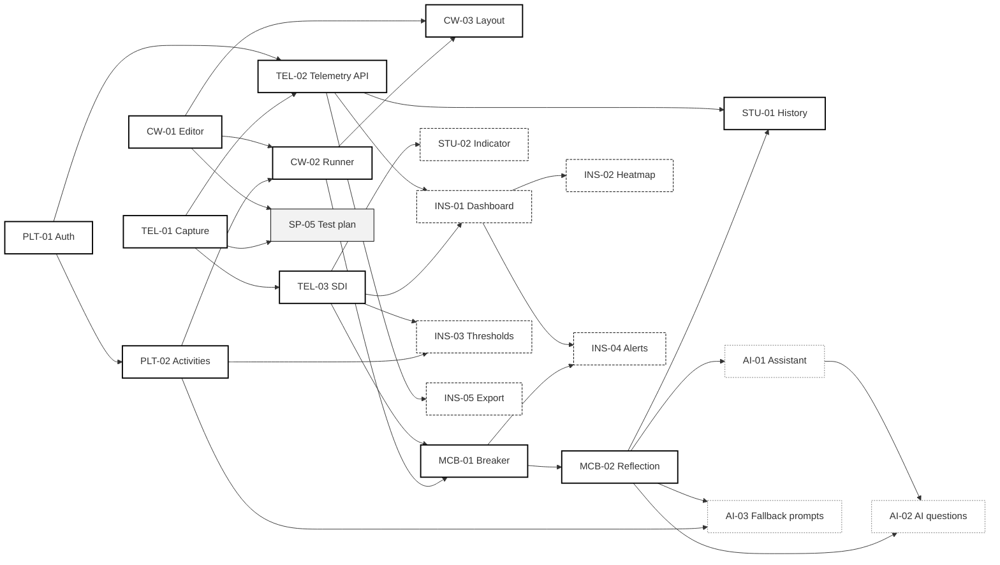

# EpistemicTrace — Trello Board Guide

| | |
|---|---|
| **Board** | [Episteme Labs — EpistemicTrace](https://trello.com/b/nwPfFX7D/episteme-labs-epistemictrace) |
| **Snapshot date** | 2026-10-29 (board last changed 2026-10-23) |
| **Maintained by** | Episteme Labs (Adrian, Noel, Jacob) |

This file explains how the team's Trello board is organized and mirrors its cards, so that contributors and AI agents can plan work without opening Trello.

**Source of truth:**

| Topic | Authoritative source |
|---|---|
| A card's **list (status), members and due date** | Trello. The status columns here are a dated snapshot. |
| A card's **scope, acceptance criteria, priority and dependencies** | The card and this file must match. Change both in the same step ([§12](#12-keeping-this-file-in-sync)). |
| Product requirements and architecture | [`PROJECT.md`](PROJECT.md) |
| Agent rules | [`../AGENTS.md`](../AGENTS.md) |

---

## Contents

1. [Board at a glance](#1-board-at-a-glance)
2. [Lists (workflow statuses)](#2-lists-workflow-statuses)
3. [Workflow rules](#3-workflow-rules)
4. [Labels](#4-labels)
5. [Team and workload](#5-team-and-workload)
6. [Card template](#6-card-template)
7. [Epics](#7-epics)
8. [Card inventory](#8-card-inventory)
9. [Dependencies](#9-dependencies)
10. [Milestones](#10-milestones)
11. [Progress snapshot](#11-progress-snapshot)
12. [Keeping this file in sync](#12-keeping-this-file-in-sync)
13. [Traceability: Trello ↔ GitHub](#13-traceability-trello--github)
14. [Board issues and gaps](#14-board-issues-and-gaps)
15. [Change log](#15-change-log)

---

## 1. Board at a glance

- **24 open cards:** 20 feature cards in 7 epics, plus 4 sprint/process cards (`SP-*`).
- **Estimated effort:**

  | Group | Hours |
  |---|---|
  | Must | 93 |
  | Should | 37 |
  | Could | 22 |
  | Process | 12 |
  | **Total** | **164** |

- **Status:** 8 cards in **To Do** and 16 in **Backlog**. Nothing is In Progress, For Review, Testing or Done.
- **Milestone 1** (board foundation) cards were archived on 2026-10-23 ([§10](#10-milestones)).
- **No due dates** are set except on CW-01 (2026-10-17 00:19 GMT+8, already passed). No sprint start date is confirmed.

## 2. Lists (workflow statuses)

The six lists, in order, from card M1-02:

| # | List | Meaning |
|---|---|---|
| 1 | **Backlog** | Not yet planned for work. *(Inferred: M1-02 defines meanings for the other five lists only.)* |
| 2 | **To Do** | Planned. |
| 3 | **In Progress** | Started (requires an assignee and acceptance criteria). |
| 4 | **For Review** | Pull request opened. |
| 5 | **Testing** | Reviewer approved; acceptance criteria being verified. |
| 6 | **Done** | Acceptance criteria verified, with evidence attached. |

An archived "Trello Starter Guide" list holds Trello's default tutorial cards. It is not part of the workflow.

## 3. Workflow rules

These are the rules from card SP-01, which the team adopted. SP-01 also requires posting them on a card at the top of the Backlog list. **That card does not exist yet** (see B-02).

1. A card cannot move to **In Progress** without an assignee and acceptance criteria.
2. A card cannot move to **Done** without a completed review and verification evidence.
3. **For Review** requires an open pull request.
4. **Testing** starts after reviewer approval.
5. Maximum **2 cards In Progress** per member.
6. Member D (the professor) only monitors progress and is **never an assignee or reviewer**.

**Also agreed (SP-07, to be written into `CONTRIBUTING.md`):**

- Every PR needs at least one peer reviewer who is not the author.
- `main` is stable only.
- Branches are named `feature/<issue#>-name` or `fix/<issue#>-name`.
- Real secrets are never committed.

## 4. Labels

| Label | Color | Used for |
|---|---|---|
| `epic:PLT` | purple | Platform: auth, activities |
| `epic:CW` | blue | Coding workspace: editor, execution, layout |
| `epic:TEL` | orange | Telemetry and SDI |
| `epic:MCB` | red (light) | Metacognitive circuit breaker |
| `epic:STU` | green (light) | Student-facing history and indicator |
| `epic:INS` | yellow (dark) | Instructor analytics and settings |
| `priority:must` | red | MoSCoW Must |
| `priority:should` | yellow | MoSCoW Should |
| `priority:could` | black (light) | MoSCoW Could |
| `type:task` | black (light) | Process task |
| `type:docs` | lime (dark) | Documentation task |
| `type:feature` | sky (dark) | Defined, currently unused |

**Gap:** there is no `epic:AI` label, so the AI-* cards carry only `priority:could` (B-04).

## 5. Team and workload

| Member | Person | Cards owned (assignee) | Feature hours | Process hours | Total |
|---|---|---|---|---|---|
| A | Adrian Bona | CW-01, CW-02, TEL-03, MCB-01, AI-01 | 50 | 0 | **50** |
| B | Noel Arcenio Cortes | PLT-01, TEL-01, TEL-02, STU-01, INS-01, INS-05, AI-03 | 49 | 0 | **49** |
| C | Jacob Roph A. Bucton | PLT-02, CW-03, MCB-02, STU-02, INS-02, INS-03, INS-04, AI-02 | 53 | 12 (SP-01, SP-04, SP-05, SP-07) | **65** |
| D | Professor | Monitors only, no cards | — | — | — |

- Assignees come from each card's **description**. Trello *members* are attached only on CW-01 (Jacob, which conflicts with the description; B-01) and TEL-01 (Noel). Attaching the owners is an SP-01 acceptance criterion.
- Member A holds the technically hardest cards: the execution sandbox (CW-02), the SDI engine (TEL-03) and the circuit breaker (MCB-01).

## 6. Card template

Every feature card is built from the CW-01 template (card M1-05). It has these fields, in this order:

```markdown
### <ID> — <Title>

- **Assignee:** Member X (Name)
- **Reviewer:** Member Y (Name)        ← never the assignee, never Member D
- **Priority:** Must Have | Should Have | Could Have
- **Estimate:** <n> hours
- **Depends on:** <IDs> | None
- **GitHub Issue:** <URL>               ← placeholder until the issue exists
- **Branch:** feature/<issue#>-<slug>  ← optional, once created

#### User Story
As a <role>, I want <capability> so that <benefit>.

#### Acceptance Criteria
- [ ] ...

#### Verification Evidence
(Attach screenshots or test output here before moving to Done)
```

- **Process cards** (`SP-*`) use `#### Description` in place of the user story.
- **Deadline:** M1-05 requires a deadline field. It is kept as the Trello due date, which is not yet set on most cards.
- **Acceptance criteria storage:** they are written as Markdown checkboxes in the description. They are **not** Trello checklist objects, so they cannot be ticked on the board (B-05).

## 7. Epics

| Epic | Name | Cards | Priority mix | Hours |
|---|---|---|---|---|
| PLT | Platform (auth, activities) | PLT-01, PLT-02 | 2 Must | 18 |
| CW | Coding workspace | CW-01, CW-02, CW-03 | 3 Must | 26 |
| TEL | Telemetry and SDI | TEL-01, TEL-02, TEL-03 | 3 Must | 27 |
| MCB | Metacognitive circuit breaker | MCB-01, MCB-02 | 2 Must | 14 |
| STU | Student experience | STU-01, STU-02 | 1 Must, 1 Should | 12 |
| INS | Instructor tools | INS-01 … INS-05 | 5 Should | 33 |
| AI | AI assistance (optional) | AI-01, AI-02, AI-03 | 3 Could | 22 |
| SP | Sprint/process tasks | SP-01, SP-04, SP-05, SP-07 | 4 Must | 12 |

The mapping from requirements (FR-*) to cards is in [`PROJECT.md` §6.1](PROJECT.md#61-functional-requirements).

## 8. Card inventory

The acceptance criteria below are copied **verbatim** from the cards as of the snapshot date. "List" is the card's list on that date.

### PLT — Platform

#### PLT-01 — User authentication and roles
| Assignee | Reviewer | Priority | Estimate | Depends on | List |
|---|---|---|---|---|---|
| B (Noel) | C (Jacob) | Must | 8 h | None | To Do |

*As a user, I want to log in as a student or instructor so that I see only my own tools.*
- [ ] Register, login and logout work
- [ ] Role (student or instructor) is stored on the account
- [ ] A student cannot open instructor pages
- [ ] Invalid login shows an error message

#### PLT-02 — Course and activity management
| Assignee | Reviewer | Priority | Estimate | Depends on | List |
|---|---|---|---|---|---|
| C (Jacob) | A (Adrian) | Must | 10 h | PLT-01 | Backlog |

*As an instructor, I want to create activities with a problem statement and test cases so students can attempt them.*
- [ ] Instructor can create, edit and archive an activity
- [ ] Test cases are saved with the activity
- [ ] Students only see published activities

### CW — Coding workspace

#### CW-01 — In-browser code editor
| Assignee | Reviewer | Priority | Estimate | Depends on | List |
|---|---|---|---|---|---|
| A (Adrian) | B (Noel) | Must | 6 h | — | To Do |

*As a student, I want to write code in the browser so I need no local setup.*
- [ ] Python syntax highlighting active
- [ ] Code persists locally on page refresh
- [ ] Monaco change events emitted on every keystroke

Due 2026-10-17 00:19 GMT+8 (passed). Trello member attached: Jacob (see B-01).

#### CW-02 — Sandboxed execution and test runner
| Assignee | Reviewer | Priority | Estimate | Depends on | List |
|---|---|---|---|---|---|
| A (Adrian) | B (Noel) | Must | 14 h | CW-01, PLT-02 | Backlog |

*As a student, I want to run my code against tests and see results so I know if it works.*
- [ ] Code runs inside a Web Worker
- [ ] Pass or fail is shown for each test case
- [ ] An infinite loop is stopped after a timeout
- [ ] Runtime errors are displayed to the student

#### CW-03 — Activity workspace layout
| Assignee | Reviewer | Priority | Estimate | Depends on | List |
|---|---|---|---|---|---|
| C (Jacob) | B (Noel) | Must | 6 h | CW-01, CW-02 | Backlog |

*As a student, I want the problem statement, editor and results in one screen so I can work without switching pages.*
- [ ] Problem statement, editor and results panel are visible together on desktop
- [ ] The results panel updates after each run

### TEL — Telemetry and SDI

#### TEL-01 — Real-time telemetry capture
| Assignee | Reviewer | Priority | Estimate | Depends on | List |
|---|---|---|---|---|---|
| B (Noel) | A (Adrian) | Must | 7 h | — | To Do |

*As the system, I want to record edits, runs, errors and timestamps so behavior can be analyzed.*
- [ ] Events (edit, run, error, pass-count) captured with timestamp and session ID
- [ ] No capture outside the activity page
- [ ] Batched telemetry payload adheres to agreed schema

The card names GitHub Issue #2 and branch `feature/2-telemetry-capture`, but neither exists (B-03). The "agreed schema" is not yet defined ([`PROJECT.md`](PROJECT.md#15-open-questions) Q-08).

#### TEL-02 — Telemetry storage and session API
| Assignee | Reviewer | Priority | Estimate | Depends on | List |
|---|---|---|---|---|---|
| B (Noel) | A (Adrian) | Must | 8 h | TEL-01, PLT-01 | Backlog |

*As the system, I want events saved per session so history and analytics are possible.*
- [ ] Events are batched and stored
- [ ] Session start and end are recorded
- [ ] A student can only write their own events

#### TEL-03 — SDI computation engine
| Assignee | Reviewer | Priority | Estimate | Depends on | List |
|---|---|---|---|---|---|
| A (Adrian) | C (Jacob) | Must | 12 h | TEL-01 | To Do |

*As the system, I want to compute a Struggle Dynamics Index over a rolling window so wheel-spinning can be detected.*
- [ ] SDI is always between 0 and 100
- [ ] Unit tests show a seeded wheel-spinning sequence scores above the threshold and a steady-progress sequence scores below it
- [ ] SDI recalculates after each run

### MCB — Metacognitive circuit breaker

#### MCB-01 — Circuit breaker trigger and runner lock
| Assignee | Reviewer | Priority | Estimate | Depends on | List |
|---|---|---|---|---|---|
| A (Adrian) | B (Noel) | Must | 8 h | TEL-03, CW-02 | Backlog |

*As a student stuck in trial-and-error, I want the system to pause my test runner so I stop and think.*
- [ ] The test runner is disabled when SDI reaches the threshold
- [ ] The editor stays usable while the runner is locked
- [ ] A cooldown prevents an immediate re-trigger

#### MCB-02 — Hypothesis and plan reflection form
| Assignee | Reviewer | Priority | Estimate | Depends on | List |
|---|---|---|---|---|---|
| C (Jacob) | B (Noel) | Must | 6 h | MCB-01 | Backlog |

*As a student, I want to state my hypothesis and planned fix so I can continue deliberately.*
- [ ] Two required fields (hypothesis and planned fix) with a minimum length
- [ ] Submitting the form unlocks the runner
- [ ] The reflection is saved with a timestamp and the linked SDI value

### STU — Student experience

#### STU-01 — Session and reflection history
| Assignee | Reviewer | Priority | Estimate | Depends on | List |
|---|---|---|---|---|---|
| B (Noel) | A (Adrian) | Must | 8 h | TEL-02, MCB-02 | Backlog |

*As a student, I want to review my past sessions and reflections so I can learn from my habits.*
- [ ] List of sessions shows date, activity, duration and reflections
- [ ] The history page opens in under 3 seconds

#### STU-02 — SDI progress indicator
| Assignee | Reviewer | Priority | Estimate | Depends on | List |
|---|---|---|---|---|---|
| C (Jacob) | A (Adrian) | Should | 4 h | TEL-03 | Backlog |

*As a student, I want a gentle indicator of my current struggle level so I can self-correct before being paused.*
- [ ] The indicator updates after each run
- [ ] It shows levels (low, medium, high) instead of a raw score or punishing wording

### INS — Instructor tools

#### INS-01 — Process analytics dashboard
| Assignee | Reviewer | Priority | Estimate | Depends on | List |
|---|---|---|---|---|---|
| B (Noel) | C (Jacob) | Should | 10 h | TEL-02, TEL-03 | Backlog |

*As an instructor, I want per-student and per-activity process metrics so I can see who struggles and how.*
- [ ] Shows runs, session time, peak SDI and breaker triggers per student
- [ ] Can be filtered by activity

#### INS-02 — Difficulty heatmap
| Assignee | Reviewer | Priority | Estimate | Depends on | List |
|---|---|---|---|---|---|
| C (Jacob) | B (Noel) | Should | 8 h | INS-01 | Backlog |

*As an instructor, I want a heatmap of activities versus struggle level so I can find problematic exercises.*
- [ ] Color reflects the average or peak SDI per activity
- [ ] Clicking a cell lists the affected students

#### INS-03 — Configurable SDI thresholds
| Assignee | Reviewer | Priority | Estimate | Depends on | List |
|---|---|---|---|---|---|
| C (Jacob) | A (Adrian) | Should | 5 h | TEL-03, PLT-02 | Backlog |

*As an instructor, I want to adjust thresholds and sensitivity per activity so the prompts fit my class.*
- [ ] Threshold and cooldown are editable per activity
- [ ] A change applies to new sessions
- [ ] Out-of-range values are rejected with a validation message

#### INS-04 — Early-warning alerts
| Assignee | Reviewer | Priority | Estimate | Depends on | List |
|---|---|---|---|---|---|
| C (Jacob) | B (Noel) | Should | 6 h | INS-01, MCB-01 | Backlog |

*As an instructor, I want to be alerted to repeated struggle patterns so I can intervene early.*
- [ ] An alert appears when a student triggers the breaker N times on one activity
- [ ] An alert can be dismissed

#### INS-05 — JSON/CSV telemetry export
| Assignee | Reviewer | Priority | Estimate | Depends on | List |
|---|---|---|---|---|---|
| B (Noel) | A (Adrian) | Should | 4 h | TEL-02 | Backlog |

*As an instructor, I want to export telemetry so I can analyze it elsewhere.*
- [ ] Export by activity and date range
- [ ] The file opens correctly in a spreadsheet
- [ ] Student identifiers can be anonymized

### AI — AI assistance (optional)

#### AI-01 — Optional AI Socratic assistant
| Assignee | Reviewer | Priority | Estimate | Depends on | List |
|---|---|---|---|---|---|
| A (Adrian) | C (Jacob) | Could | 10 h | MCB-02 | Backlog |

*As a student, I want hints in the form of guiding questions so I learn without being given the answer.*
- [ ] An opt-in toggle controls whether the assistant is shown
- [ ] The assistant never returns a full solution
- [ ] Responses are logged

#### AI-02 — AI-generated reflective questions
| Assignee | Reviewer | Priority | Estimate | Depends on | List |
|---|---|---|---|---|---|
| C (Jacob) | A (Adrian) | Could | 8 h | AI-01, MCB-02 | Backlog |

*As a student, I want reflection prompts based on my errors and hypothesis so they feel relevant.*
- [ ] The prompt references the latest error and code change
- [ ] It is shown inside the circuit breaker modal

#### AI-03 — Instructor-curated prompt fallback
| Assignee | Reviewer | Priority | Estimate | Depends on | List |
|---|---|---|---|---|---|
| B (Noel) | C (Jacob) | Could | 4 h | MCB-02, PLT-02 | Backlog |

*As an instructor, I want to write debugging prompts that appear if AI is off or fails so students always get guidance.*
- [ ] Instructor can add prompts per activity
- [ ] The fallback prompt is shown when AI is disabled or returns an error

### SP — Sprint/process tasks

#### SP-01 — Board housekeeping and workflow rules
| Assignee | Reviewer | Priority | Estimate | Depends on | List |
|---|---|---|---|---|---|
| C (Jacob) | B (Noel) | Must | 2 h | None | To Do |

*Make the board enforce the lab rules and tidy the first two feature cards.*
- [ ] Workflow rules card exists at the top of the Backlog list with all six rules
- [ ] Every team member has commented "read" on the rules card
- [ ] CW-01 and TEL-01 each have a "Verification evidence" section in the description
- [ ] Trello members (Adrian, Noel, Jacob) are attached to the cards they own
- [ ] Due dates are set on all sprint cards once the sprint start date is confirmed

#### SP-04 — Write requirements, architecture and team-roles docs
| Assignee | Reviewer | Priority | Estimate | Depends on | List |
|---|---|---|---|---|---|
| C (Jacob) | A (Adrian) | Must | 4 h | GitHub repository initialized (met: `8ac4dbe`) | To Do |

*Write the three documents required by the lab inside the repository's `docs/` folder, using the finalized concept paper as the source.*
- [ ] `docs/requirements.md` lists the 7 epics, 20 features, user stories, MoSCoW priorities and acceptance criteria
- [ ] `docs/architecture.md` describes the stack, main components and the telemetry to SDI to circuit breaker data flow
- [ ] `docs/team-roles.md` lists Adrian, Noel and Jacob with their responsibilities and states that the professor only monitors progress
- [ ] Changes are merged through a reviewed pull request

`PROJECT.md` and this file already contain this content under different file names. See B-07.

#### SP-05 — Test plan and verification evidence for CW-01 and TEL-01
| Assignee | Reviewer | Priority | Estimate | Depends on | List |
|---|---|---|---|---|---|
| C (Jacob) | A (Adrian) | Must | 3 h | CW-01, TEL-01 | To Do |

*Independently verify the two traced features and collect the evidence needed to move their cards to Done.*
- [ ] A test plan lists one check for every acceptance criterion of CW-01 and TEL-01
- [ ] Each check is run and its result recorded (pass or fail)
- [ ] Screenshots or test output are attached to the CW-01 and TEL-01 cards
- [ ] Findings are written in the pull request review comments

#### SP-07 — Write CONTRIBUTING.md and PR template
| Assignee | Reviewer | Priority | Estimate | Depends on | List |
|---|---|---|---|---|---|
| C (Jacob) | B (Noel) | Must | 3 h | GitHub repository initialized (met) | To Do |

*Document the team's collaboration conventions so every branch, commit and pull request follows the same rules.*
- [ ] `CONTRIBUTING.md` defines branch naming (`feature/<issue#>-name` and `fix/<issue#>-name`), commit message format, and that `main` is stable only
- [ ] `CONTRIBUTING.md` states that every PR needs at least one peer reviewer who is not the author, and that real secrets are never committed
- [ ] `.github/pull_request_template.md` includes summary, linked issue, what changed, how it was tested, screenshots and a checklist
- [ ] Changes are merged through a reviewed pull request

## 9. Dependencies

An arrow `A --> B` means **B depends on A** (A must be done first). The dependencies are taken from each card's *Depends on* field.



Legend: solid thick border = Must, dashed = Should, dotted grey = Could, grey fill = process task. SP-01, SP-04 and SP-07 have no card dependencies.

**Derived observations** (computed from the graph, not team decisions):

- **Can start now** (no unmet dependencies): PLT-01, CW-01, TEL-01, SP-01, SP-04, SP-07.
- **Longest sequential chain to the MVP:** PLT-01 → PLT-02 → CW-02 → MCB-01 → MCB-02 → STU-01, which is **54 h** across three people. Delays to PLT-01 or PLT-02 hold up Member A's CW-02.
- **TEL-03 needs only TEL-01**, so the SDI engine can be built and unit-tested against seeded event sequences before the runner or the API exist.

## 10. Milestones

| Milestone | Scope | Status (2026-10-29) | Target date |
|---|---|---|---|
| **M1 — Board foundation** | Cards M1, M1-01 … M1-05: workspace and members, six lists, labels, rules card, CW-01 template | **Archived 2026-10-23.** The team did this setup directly. Leftovers carried into SP-01: the rules card, and attaching members. `epic:AI` is still missing (B-04). | — |
| **Sprint 1** *(working name)* | The 8 cards currently in To Do: SP-01, SP-04, SP-05, SP-07, PLT-01, CW-01, TEL-01, TEL-03 | Not started. Start date not confirmed (SP-01 AC 5). | Not set |
| **MVP** | All 11 Must feature cards (93 h); the end-to-end loop in [`PROJECT.md` §10](PROJECT.md#10-data-flow) | Not started | Not set (Q-10) |
| **Should-haves** | STU-02, INS-01 … INS-05 (37 h) | Not started | Not set |
| **Could-haves** | AI-01 … AI-03 (22 h) | Not started | Not set |

- "Sprint 1" is this document's label for the current To Do set. The board does not name sprints.
- Course-level milestones (term dates, MVP demo, pilot) are tracked as Q-10 in [`PROJECT.md`](PROJECT.md#15-open-questions).

## 11. Progress snapshot

**As of 2026-10-29.** Re-check Trello before relying on it.

| List | Cards |
|---|---|
| Backlog | 16: PLT-02, CW-02, CW-03, TEL-02, MCB-01, MCB-02, STU-01, STU-02, INS-01 … INS-05, AI-01 … AI-03 |
| To Do | 8: SP-01, SP-04, SP-05, SP-07, PLT-01, CW-01, TEL-01, TEL-03 |
| In Progress | 0 |
| For Review | 0 |
| Testing | 0 |
| Done | 0 |

| Measure | Value |
|---|---|
| Must feature hours completed | 0 / 93 |
| Cards with a GitHub issue | 0 / 24 (the repo has no issues or PRs) |
| Cards with verification evidence | 0 |
| Last board activity | 2026-10-23 |

## 12. Keeping this file in sync

**Update this file in the same pull request when:**

- a card is created, removed, renamed, split or merged;
- a card's priority, estimate, assignee, reviewer, dependencies or acceptance criteria change;
- a milestone starts, is re-scoped, or completes;
- the board's lists, labels or workflow rules change.

**Then:**

- Refresh [§11](#11-progress-snapshot) and the snapshot date at least at each sprint boundary. *(Proposed cadence; the team has not set one.)*
- If a change affects requirements or architecture, update [`PROJECT.md`](PROJECT.md) too.
- AI agents edit this file but **do not move, create or edit Trello cards** unless a team member explicitly asks ([`AGENTS.md`](../AGENTS.md)).

## 13. Traceability: Trello ↔ GitHub

**Agreed** (rules 1–3, SP-07, card template):

- Each feature card gets a **GitHub issue**, and the issue URL is pasted into the card's *GitHub Issue* field.
- Work happens on `feature/<issue#>-<name>` (or `fix/<issue#>-<name>`).
- Opening a **pull request** moves the card to *For Review*. The PR uses `.github/pull_request_template.md` (to be added by SP-07), which includes the linked issue.
- After a non-author approves, the card moves to *Testing*. When each acceptance criterion is verified and the evidence is attached, it moves to *Done*.

**Recommended** (not yet agreed):

- Put the card ID in the issue title and the PR title, for example `TEL-01: Real-time telemetry capture`.
- Write `Closes #<issue>` in the PR body.

**Current state:** the repository has no issues, no PRs and only the default GitHub labels.

## 14. Board issues and gaps

These are found on the board and left for the team to resolve. They have not been changed on Trello.

| ID | Issue | Suggested fix |
|---|---|---|
| B-01 | CW-01's description says assignee **Member A (Adrian)**, but the Trello member attached is **Jacob**. | Confirm the owner; fix either the description or the member. |
| B-02 | The workflow-rules card required by SP-01 does not exist. | Create it at the top of Backlog (SP-01). |
| B-03 | TEL-01 references GitHub Issue #2 and branch `feature/2-telemetry-capture`, but neither exists. | Create the issue and update the card to the real number. |
| B-04 | There is no `epic:AI` label; the AI-* cards have only a priority label. | Add `epic:AI` and apply it. |
| B-05 | Acceptance criteria are Markdown in the descriptions, not Trello checklists (M1-05 noted the same). | Optionally convert them to checklists so progress is visible. |
| B-06 | Card numbering skips SP-02, SP-03 and SP-06; no such cards exist. The repo scaffold (`8ac4dbe`, 2026-10-25) is the "repository initialized" dependency of SP-04/SP-07. | Confirm whether those tasks were done outside Trello or dropped. |
| B-07 | SP-04's acceptance criteria name `docs/requirements.md`, `docs/architecture.md` and `docs/team-roles.md`; this repo now has `docs/PROJECT.md` and `docs/TRELLO.md` covering the same content. | Decide: update the SP-04 criteria to these files, or split them out ([`PROJECT.md`](PROJECT.md#15-open-questions) Q-20). |
| B-08 | No requirement card exists for the **consent notice** or for **instructor review of reflections**, both of which are in the CSIT321 doc. | Add cards or fold them into PLT-01 / TEL-01 / STU-01 or INS-01 (Q-05, Q-06). |
| B-09 | No due dates are set, except CW-01's, which has passed. | Set dates when the sprint start is confirmed (SP-01). |

## 15. Change log

| Date | Change |
|---|---|
| 2026-10-29 | First version: mirrored 24 open cards, lists, labels, rules and the archived M1 milestone from the board; recorded B-01 … B-09. |
